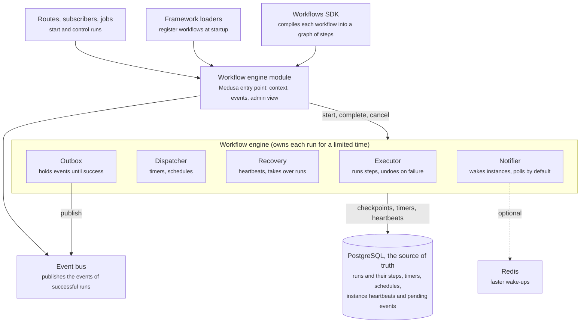

# Workflow Engine Architecture

The workflow engine runs every Medusa workflow on one engine that keeps its state in the application's PostgreSQL database. It replaces the previous in-memory and Redis engines, so the same engine serves development and production, a single instance and a fleet of server and worker instances.

The idea behind it: a workflow is compiled once into a fixed graph of steps, and a run moves through that graph by saving checkpoints. Everything else (retries, timers, schedules, crash recovery, events) is built on top of those saved checkpoints rather than on in-process memory.

## How it works

Application code and the framework only talk to the workflow engine module; the module drives the engine, and the engine keeps all of its state in PostgreSQL.

The life of a run:

1. **Startup.** The framework finds the workflows the application defines and registers them with the module. The SDK has already compiled each one into a graph of steps.
2. **Start.** A route, subscriber, job or another workflow asks the module to run a workflow. The engine creates the run and takes ownership of it for a limited time, so no other instance works on it at the same time.
3. **Execute.** The engine runs every step whose dependencies are done, in parallel where the graph allows. It saves a checkpoint as the run progresses; how often depends on how much the workflow needs to survive a crash.
4. **Wait.** When a step must wait (an async step, a retry delay, a timeout), the engine saves the run and a timer, releases it, and moves on. Any instance can pick the run up again when the timer is due or when the step is completed from outside.
5. **Finish.** The run ends as succeeded, compensated (failed and undone), cancelled or failed. Events its steps emitted are published only if it succeeded, the parent run is notified if there is one, and the run is kept for as long as the workflow asks.
6. **Recover.** If an instance dies, its ownership of runs expires and another instance resumes them from their last checkpoint.

## Components

The engine is a small set of parts with one job each; the Medusa-specific parts sit around it, not inside it.

| Component | What it does |
| --- | --- |
| **Workflows SDK** | Turns the `createWorkflow` / `createStep` code developers write into a fixed graph of steps, once, when the application loads. The same code always produces the same graph, so any instance can continue any run. |
| **Workflow engine module** | Medusa's entry point. Registers workflows, starts and cancels runs, completes async steps, lets callers subscribe to a run, and lists executions for the admin. It keeps the API that existed before the rewrite. |
| **Registry** | Holds the compiled workflows an instance knows. A run only executes on an instance that has the same version of its workflow. |
| **Executor** | Drives one run: starts ready steps, applies their results, retries failures, and undoes completed steps in reverse order when the run fails or is cancelled. |
| **Store** | The single source of truth for runs, steps, timers, schedules, instance heartbeats and pending events. PostgreSQL in applications; an in-memory version for tests. |
| **Ownership (leases)** | A run is owned by one instance at a time, for a limited time. Every save checks ownership, so an instance that lost a run can't overwrite it. |
| **Dispatcher** | Wakes up for due work: retry delays, timeouts, async continuations and scheduled workflows. Instances claim due work so each item is handled once. |
| **Recovery** | Instances send heartbeats, which keep their runs owned. When one stops, the runs it owned are handed to the others, and background steps it was running are retried. One instance at a time does this checking for all of them. |
| **Notifier** | Optional. Tells other instances that work is ready so they don't wait for their next check. Redis; without one, instances check periodically. |
| **Outbox** | Holds the events a run's steps emit, inside the run's own saves, and publishes them through the event bus once the run succeeds. Events of failed attempts and undone steps are dropped. |
| **Extensions** | Hooks around runs and steps. Tracing and the outbox are built as extensions, and so is the module's own bookkeeping. |
| **Context injection** | Gives module services called from a step the run's context automatically, such as its event group and an idempotency key. |
| **Admin view** | Maps runs to the execution shape the admin and the HTTP API expect, including each step's dependencies and its position in the graph. |

## Features

Workflows keep every capability they had before, and gain crash recovery and reliable event delivery.

- **Composition:** steps, parallel branches, conditional blocks, data transforms, hooks, and workflows run as steps of other workflows.
- **Failure handling:** automatic retries, with or without a delay between attempts; steps that wait for a manual retry; continuing or skipping past a step that fails for good.
- **Compensation:** when a run fails or is cancelled, completed steps are undone in reverse order.
- **Long-running work:** async steps that wait for an outside system to report success or failure, and steps that run in the background on a worker.
- **Timeouts** for single steps and for whole runs.
- **Scheduling:** run a workflow on a cron expression or an interval, optionally a limited number of times, without overlapping executions unless allowed.
- **Run control:** start, cancel, complete or fail a waiting step, retry a step, and subscribe to a run's progress.
- **Idempotency and retention:** running a workflow again with the same transaction returns the earlier result when asked, and finished runs can be kept for the admin for a set time.
- **Durability levels:** short workflows that need no persistence aren't saved at all; others are saved at start and end, or after every step. The engine picks the level from the workflow, and a workflow can ask for more.
- **Grouped events:** events emitted during a run are published once it succeeds and dropped if it fails. Delivery is at least once.
- **Typed runs:** running a workflow through the module infers its input and result types.
- **Admin visibility:** the admin lists executions and shows each run's steps, their states, the graph they form, and errors.

## Modes of operation

The same engine runs in every deployment shape; only which instance does which work changes.

- **Single instance:** one process starts runs, executes steps, and handles timers and schedules. Typical for development.
- **Server and worker instances:** a server instance runs the steps of the workflows it starts until they finish or wait, then hands the rest (retry delays, timeouts, async continuations, background steps, schedules) to worker instances. Workers do all background work.
- **Wake-ups:** instances check the database for due work periodically by default. An optional Redis notifier lets them react within milliseconds instead, and checking then only catches wake-ups that were lost. Instances spread their checks out so they don't all hit the database at once.
- **Crash recovery:** with PostgreSQL, instances heartbeat and take over each other's runs after a crash, resuming from the last checkpoint. One instance finds the orphaned runs and any worker resumes them, so recovery speeds up with the number of workers.
- **Graceful shutdown:** an instance stops taking new work, gives running steps a grace period, then hands its runs over.
- **Tests:** an in-memory store runs the engine in a single process with no database; it has no crash recovery.

## Dependencies

The engine needs nothing beyond the PostgreSQL database Medusa already uses.

- **PostgreSQL** (required): holds all engine state; the module's migrations create its tables and reuse the application's connection pool.
- **Event bus** (required, any provider): publishes the events workflows emit.
- **Redis** (optional): only as a notifier for faster wake-ups between instances.
- **Packages:** the engine is a standalone package with no Medusa dependencies and two small libraries (cron parsing and id generation). The SDK compiles to it, and the workflow engine module connects it to Medusa. The old orchestration package and the in-memory and Redis engine modules are removed.
