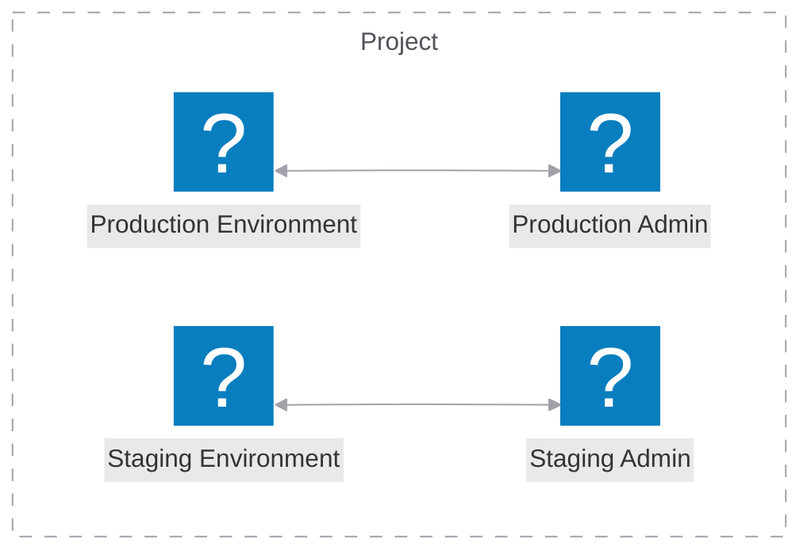

import { Note } from "docs-ui"

export const metadata = {
  title: `Medusa Admin on Cloud`,
}

# {metadata.title}

In this guide, you'll learn how Medusa deploys the Medusa Admin of your Cloud project, and how to access it, log in, and customize it.

## Medusa Admin Overview

The [Medusa Admin](!user-guide!) is the dashboard that merchants use to manage their store, such as its products, orders, customers, and settings. It's part of your Medusa application, so you don't deploy or host it separately.

Medusa builds the Medusa Admin with your Medusa backend, and the backend serves it at the `/app` path of the backend's URL.

### Medusa Admin Per Environment

Medusa deploys the Medusa Admin in every long-lived and preview [environment](../environments/page.mdx) of your project, including the Production environment.

Each environment's Medusa Admin connects to that environment's backend and database. So, the store settings, products, and admin users that you manage in one environment's Medusa Admin don't affect other environments.

---

## Access the Medusa Admin

You can access the Medusa Admin of an environment once its deployment is live.

To open the Medusa Admin, click the backend URL in the environment's card on the project's dashboard, or navigate to `<backend-url>/app`. For example, if your environment's backend URL is `my-project.medusajs.app`, navigate to `my-project.medusajs.app/app`.

Learn how to find an environment's backend URL in the [Access Deployment](../deployments/access/page.mdx#find-backend-and-admins-url) guide. For preview environments, refer to the [Preview Environments](../environments/preview/page.mdx#access-deployed-preview-environment) guide.

### Log in with Your Cloud Account

You can log into your Medusa Admin project deployed on Cloud using your Cloud account.

On the Medusa Admin's log in page, click the **Log in with Medusa Cloud** button and log in with your Cloud account. Medusa creates a user in the Medusa application with the same email as your Cloud account.

<Note title="Can't Find the Log in with Medusa Cloud Button?">

Refer to the [Access Deployment](../deployments/access/page.mdx#cant-find-the-log-in-with-medusa-cloud-button) guide for troubleshooting steps.

</Note>

### Access With a Custom Domain

The Medusa Admin uses the same domain as your backend. If you set up a [backend custom domain](../environments/custom-domains/page.mdx#backend-custom-domains), you can access the Medusa Admin at the `/app` path of the custom domain.

### Merchant Guides for the Medusa Admin

To learn how to manage your store from the Medusa Admin, such as adding products, fulfilling orders, and configuring regions, refer to the [Merchant Guides](!user-guide!).

---

## Manage Admin Users

To give team members who don't have a Cloud account access to the Medusa Admin, [invite them as admin users](!user-guide!/settings/users) from the Medusa Admin's settings. Admin users are unlimited on all plans.

An admin user can manage the store in the environment they're invited to. To give them access to more environments, invite them from each environment's Medusa Admin.

---

## Customize the Medusa Admin

You can, with the help of your AI agent, extend the Medusa Admin with your own widgets and pages in your Medusa application's codebase. Medusa then builds and deploys your customizations with the backend when you push them to an environment's branch.

You can create custom pages to display custom data models like brands, add new sections to existing pages, or add settings pages to manage custom configurations.

Learn how to customize the Medusa Admin in the [Admin Development](!docs!/learn/fundamentals/admin) guides.

### Medusa Admin Environment Variables

Your Medusa Admin customizations can only use backend environment variables prefixed with `VITE_`. Medusa inlines these variables into the Medusa Admin when it builds your application.

So, when you [add a backend environment variable](../environments/environment-variables/page.mdx#add-environment-variables-on-cloud) that the Medusa Admin uses, enable its **Build** toggle. After you change the variable's value, start a new build of the environment for the change to take effect. Redeploying an existing deployment reuses its previous build.

Learn more in the [Admin Environment Variables](!docs!/learn/fundamentals/admin/environment-variables) chapter.

<Note type="warning">

Medusa Admin environment variables are public and exposed to the client-side code. Do not include sensitive information, such as API keys or secrets, in these variables. Instead, store sensitive information in your backend environment variables and access them securely from your server-side code.

</Note>

---

## Restrict Access to the Medusa Admin

Users must log in before they can view or manage your store's data in the Medusa Admin. However, Cloud doesn't have an option to restrict who can open the Medusa Admin's URL, such as with an IP allowlist.

To keep search engines from crawling your backend's domain, which serves the Medusa Admin, refer to the [Prevent Crawling of the Medusa Backend](../deployments/access/page.mdx#prevent-crawling-of-the-medusa-backend) section.
