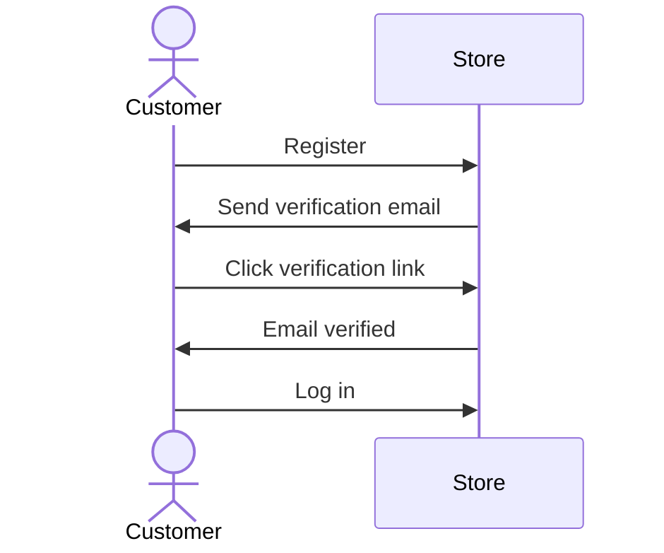

import { Prerequisites, Note } from "docs-ui"

export const metadata = {
  title: `Send Email Verification Notification`,
}

# {metadata.title}

In this guide, you'll learn how to enable email verification requirement for customers in your Medusa application, and how to send email verification notifications.

<Note>

The steps of this guide have changed since Medusa [v2.16.0](https://github.com/medusajs/medusa/releases/tag/v2.16.0). It now uses the `http.authVerificationsPerActor` configuration instead of the `require_verification` option in the Emailpass Auth Module Provider.

</Note>

<Prerequisites
  items={[
    {
      text: "Medusa v2.16.0 or later",
      link: "!docs!/learn/update"
    },
    {
      text: "Medusa Emails on Cloud, or another Notification Module Provider for the email channel",
      link: "!cloud!/emails"
    }
  ]}
/>

## How Email Verification Works

By default, customers can register an account and log in to your Medusa store without verifying their email address. You can enable email verification to require customers to verify their email address before they can log in.

When email verification is enabled, the customer registration flow changes to the following:



1. A customer registers an account by providing their email and password.
2. The customer receives an email with a verification link. The link points to a page in your storefront that verifies the customer's email when visited.
3. The customer clicks the verification link, which verifies their email address and completes the registration process.
4. The customer can now log in to their account.

This guide focuses on the backend implementation of this flow, which involves enabling email verification and sending the verification email.

To implement the storefront part of the flow, refer to the [Verify Customer Account in Storefront guide](../../../storefront-development/customers/verify-account/page.mdx).

---

## Enable Email Verification

To enable email verification, set the `http.authVerificationsPerActor` configuration in `medusa-config.ts`:

export const configHighlights = [
  ["6", "authVerificationsPerActor", "Object specifying the required verification methods per actor type. Include `customer` to require email verification for customers."],
]

```ts title="medusa-config.ts" highlights={configHighlights}
module.exports = defineConfig({
  // ...
  projectConfig: {
    // ...
    http: {
      authVerificationsPerActor: {
        customer: [
          {
            entity_type: "email",
            auth_provider: "emailpass",
          },
        ],
      },
    },
  },
})
```

The `http.authVerificationsPerActor` configuration is an object that specifies the required verification methods for each actor type. The value for each actor type is an array of objects, each specifying a verification method. In this case, you include the `customer` actor type and specify that email verification is required using the `emailpass` auth provider.

<Note>

Learn more in the [authVerificationsPerActor configuration reference](!docs!/learn/configurations/medusa-config#httpauthVerificationsPerActor).

</Note>

---

## Send Email Verification Notification

When the storefront requests to send an email verification notification, Medusa emits the `auth.verification_requested` event. You can listen to this event in a [subscriber](!docs!/learn/fundamentals/events-and-subscribers) to send the email verification notification.

<Note>

The `auth.verification_requested` event payload changed in Medusa v2.17.0. The `actor_type` and `provider_identity_id` fields were removed, `provider` was renamed to `code_provider`, and `entity_type` was added. If you have a subscriber written before v2.17.0, update it to use the payload described in this guide.

</Note>

### Prerequisite Configurations

#### Email Sending

To send an email to the user, you need a Notification Module Provider registered for the `email` channel.

Cloud projects send notifications of the `email` channel with [Medusa Emails](!cloud!/emails), Cloud's built-in email service. Medusa Emails is enabled by default, so you don't need to configure a Notification Module Provider or add API keys.

<Note>

Without a verified sender domain, Medusa Emails only sends emails to addresses of users in your Cloud organization. To send email verification emails to other email addresses, [add an email sender domain](!cloud!/emails#add-email-sender-domain-to-cloud) to your Cloud project.

</Note>

If you're not using Cloud, you can use another [Notification Module Provider](../../../infrastructure-modules/notification/page.mdx#what-is-a-notification-module-provider) for the `email` channel, or [create your own custom provider](/references/notification-provider-module).

##### Testing with the Local Notification Module Provider

Medusa Emails isn't available when you run the Medusa application locally. So, register the [Local Notification Module Provider](../../../infrastructure-modules/notification/local/page.mdx) for the `email` channel during development by adding this to your `medusa-config.ts`:

```ts title="medusa-config.ts"
module.exports = defineConfig({
  // ...
  modules: [
    {
      resolve: "@medusajs/medusa/notification",
      options: {
        providers: [
          // ...
          {
            resolve: "@medusajs/medusa/notification-local",
            id: "local",
            options: {
              channels: [
                process.env.NODE_ENV === "development"
                  ? "email"
                  : "feed",
              ],
            },
          },
        ],
      },
    },
  ],
})
```

The Local provider logs email details to your terminal instead of sending actual emails, which is useful for development and testing. It handles the `email` channel only in development, so Medusa Emails sends the emails in your Cloud environments.

#### Storefront URL Configuration

To format the verification link in the email, you need to set the URL to your storefront in `medusa-config.ts`. You can use the `admin.storefrontUrl` configuration for that:

```ts title="medusa-config.ts"
module.exports = defineConfig({
  // ...
  admin: {
    storefrontUrl: process.env.STOREFRONT_URL || "https://storefront.com",
  },
})
```

This will allow you to use the `admin.storefrontUrl` value in the subscriber when formatting the verification link. If `admin.storefrontUrl` is not set, you can use a placeholder URL as shown in the subscriber example below.

### Email Verification Notification Subscriber

To send the email verification notification when the `auth.verification_requested` event is emitted, create a [subscriber](!docs!/learn/fundamentals/events-and-subscribers) at `src/subscribers/send-email-verification.ts` with the following content:

```ts title="src/subscribers/send-email-verification.ts"
import {
  SubscriberArgs,
  type SubscriberConfig,
} from "@medusajs/medusa"
import {
  Modules,
  ContainerRegistrationKeys,
} from "@medusajs/framework/utils"

export default async function verificationRequestedHandler({
  event: { data: {
    entity_id: email,
    entity_type,
    code,
  } },
  container,
}: SubscriberArgs<{
  entity_id: string
  entity_type: string
  code_provider: string
  auth_identity_id: string
  code: string
  expires_at: string
  metadata?: Record<string, unknown>
}>) {
  // only handle email verifications.
  if (entity_type !== "email") {
    return
  }

  const notificationModuleService = container.resolve(
    Modules.NOTIFICATION
  )
  const config = container.resolve(
    ContainerRegistrationKeys.CONFIG_MODULE
  )

  const urlPrefix = config.admin.storefrontUrl || "https://storefront.com"

  console.log(`${urlPrefix}/verify-account?token=${code}&email=${email}`)

  const verificationUrl = `${urlPrefix}/verify-account` +
    `?token=${code}&email=${email}`

  await notificationModuleService.createNotifications({
    to: email,
    channel: "email",
    content: {
      subject: "Verify your email",
      html: `<p>Click <a href="${verificationUrl}">here</a> to verify your email.</p>`,
    },
  })
}

export const config: SubscriberConfig = {
  event: "auth.verification_requested",
}
```

#### Event Payload

This subscriber receives in the event payload an object with the following properties:

- `entity_id`: The identifier of the provider identity to verify. For email verification, this is the customer's email address.
- `entity_type`: The kind of entity being verified, such as `email`. You check that it's `email` before sending the notification, since you only want to handle email verifications.
- `code`: The verification code to include in the verification link. When the customer clicks the verification link, the storefront should send the code back to the Medusa application to verify the customer's email address.
- `code_provider`: The verification provider used to generate the code. By default, this is `token`.
- `auth_identity_id`: The ID of the auth identity for which the verification was requested.
- `expires_at`: The date and time at which the verification code expires.
- `metadata`: Optional metadata included in the verification request.

#### Subscriber Implementation

In the subscriber, you first check that the `entity_type` is `email` to only handle email verifications. Then, you format the storefront URL either using the value of `admin.storefrontUrl` set in `medusa-config.ts` or a placeholder URL. You need this URL to format the verification link sent in the email.

Then, you send a notification using the Notification Module's main service. You pass the following properties to the `createNotifications` method:

- `to`: The email address of the customer to which the verification email should be sent.
- `channel`: The channel to send the notification through. In this case, it's `email`.
- `content`: The email's subject and HTML content, which includes the verification link. On Cloud, Medusa Emails sends this content to the customer.
    - Refer to the [Use a React Email Template](#use-a-react-email-template) section below to build a richer email template.

The verification link points to a page in your storefront, such as `/verify-account`, which should handle verifying the customer's email when visited.

---

## Handle Email Verification in Storefront

When the customer clicks the verification link, they should be directed to a page in your storefront that sends the token back to the Medusa application to verify the customer's email address.

To learn how to implement this part of the flow, refer to the [Verify Customer Account in Storefront guide](../../../storefront-development/customers/verify-account/page.mdx).

---

## Use a React Email Template

The subscriber sends a basic HTML email. To build a richer email template, use [React Email](https://react.email) to create the template as a React component, then render it to an HTML string in the subscriber.

First, install React Email in your Medusa project as explained in the [Set Up React Email Templates](!cloud!/emails/react-email#step-1-install-react-email-dependencies) guide.

Then, create the email verification template at `src/emails/email-verification.tsx`:

```tsx title="src/emails/email-verification.tsx"
import { 
  Text, 
  Container, 
  Heading, 
  Html, 
  Section, 
  Tailwind, 
  Head, 
  Preview, 
  Body, 
  Link,
  Button, 
} from "@react-email/components"

type EmailVerificationEmailProps = {
  verification_url: string
}

function EmailVerificationEmailComponent({ verification_url }: EmailVerificationEmailProps) {
  return (
    <Html>
      <Head />
      <Preview>Verify your email</Preview>
      <Tailwind>
        <Body className="bg-white my-auto mx-auto font-sans px-2">
          <Container className="border border-solid border-[#eaeaea] rounded my-[40px] mx-auto p-[20px] max-w-[465px]">
            <Section className="mt-[32px]">
              <Heading className="text-black text-[24px] font-normal text-center p-0 my-[30px] mx-0">
                Verify Your Email
              </Heading>
            </Section>

            <Section className="my-[32px]">
              <Text className="text-black text-[14px] leading-[24px]">
                Hello,
              </Text>
              <Text className="text-black text-[14px] leading-[24px]">
                Thanks for creating an account. Please confirm your email address by clicking the button below to complete your registration.
              </Text>
            </Section>

            <Section className="text-center mt-[32px] mb-[32px]">
              <Button
                className="bg-[#000000] rounded text-white text-[12px] font-semibold no-underline text-center px-5 py-3"
                href={verification_url}
              >
                Verify Email
              </Button>
            </Section>

            <Section className="my-[32px]">
              <Text className="text-black text-[14px] leading-[24px]">
                Or copy and paste this URL into your browser:
              </Text>
              <Link
                href={verification_url}
                className="text-blue-600 no-underline text-[14px] leading-[24px] break-all"
              >
                {verification_url}
              </Link>
            </Section>

            <Section className="my-[32px]">
              <Text className="text-[#666666] text-[12px] leading-[24px]">
                This verification link will expire soon for security reasons.
              </Text>
              <Text className="text-[#666666] text-[12px] leading-[24px] mt-2">
                If you didn't create an account, you can safely ignore this email.
              </Text>
            </Section>

            <Section className="mt-[32px] pt-[20px] border-t border-solid border-[#eaeaea]">
              <Text className="text-[#666666] text-[12px] leading-[24px]">
                For security reasons, never share this verification link with anyone. If you're having trouble with the button above, copy and paste the URL into your web browser.
              </Text>
            </Section>
          </Container>
        </Body>
      </Tailwind>
    </Html>
  )
}

export default function getEmailVerificationTemplate(
  props?: EmailVerificationEmailProps
) {
  return (
    <EmailVerificationEmailComponent
      verification_url={props?.verification_url ?? "#"}
    />
  )
}
```

Feel free to customize the email template further to match your branding and style, or to add additional information.

Finally, in the subscriber at `src/subscribers/send-email-verification.ts`, render the template to HTML and pass it in the notification's content:

```ts title="src/subscribers/send-email-verification.ts"
// other imports...
import { render } from "@react-email/render"
import getEmailVerificationTemplate from "../emails/email-verification"

export default async function verificationRequestedHandler({
  // ...
}: SubscriberArgs<{
  // ...
}>) {
  // ...

  await notificationModuleService.createNotifications({
    to: email,
    channel: "email",
    content: {
      subject: "Verify your email",
      html: await render(getEmailVerificationTemplate({
        verification_url: verificationUrl,
      })),
    },
  })
}
```
